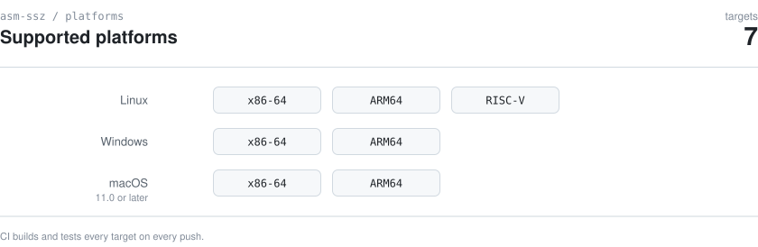
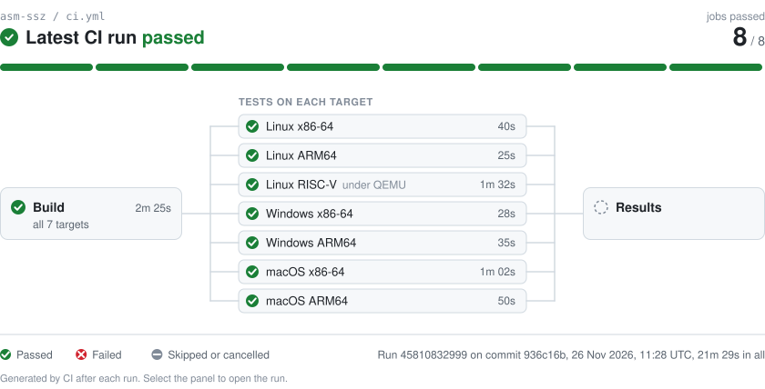

# asm-ssz

SimpleSerialize (SSZ) for Ethereum, in assembly.

Standard: [asm-standard@0db3e07](https://github.com/bitminetech/asm-standard/blob/0db3e07f58a9ba89c5b6a46925b179de265ee7e8/ARCHITECTURE.md)

<!-- CI generates the supported platforms panel here. -->
<table><tr><td>

<picture><source media="(prefers-color-scheme: dark)" srcset="docs/readme/platforms-dark.svg"></picture>

</td></tr></table>
<!-- End of the supported platforms panel. -->

<!-- CI generates the verification heatmap here. -->
<table><tr><td>

<picture><source media="(prefers-color-scheme: dark)" srcset="docs/heatmap/header-dark.svg"></picture>

<picture><source media="(prefers-color-scheme: dark)" srcset="docs/heatmap/label-merkleization-dark.svg"></picture><a href="docs/reference/merkleization.md#function-ssz_hash_tree_root"><picture><source media="(prefers-color-scheme: dark)" srcset="docs/heatmap/cell-0-dark.svg"></picture></a><a href="docs/reference/merkleization.md#function-ssz_hash_pair"><picture><source media="(prefers-color-scheme: dark)" srcset="docs/heatmap/cell-0-dark.svg"></picture></a><a href="docs/reference/merkleization.md#function-ssz_value_level"><picture><source media="(prefers-color-scheme: dark)" srcset="docs/heatmap/cell-0-dark.svg"></picture></a><a href="docs/reference/merkleization.md#function-ssz_child_level"><picture><source media="(prefers-color-scheme: dark)" srcset="docs/heatmap/cell-0-dark.svg"></picture></a><a href="docs/reference/merkleization.md#function-ssz_level_leaf"><picture><source media="(prefers-color-scheme: dark)" srcset="docs/heatmap/cell-0-dark.svg"></picture></a><a href="docs/reference/merkleization.md#function-ssz_level_root"><picture><source media="(prefers-color-scheme: dark)" srcset="docs/heatmap/cell-0-dark.svg"></picture></a><a href="docs/reference/merkleization.md#function-ssz_subtree_root"><picture><source media="(prefers-color-scheme: dark)" srcset="docs/heatmap/cell-0-dark.svg"></picture></a> 
<picture><source media="(prefers-color-scheme: dark)" srcset="docs/heatmap/label-proofs-dark.svg"></picture><a href="docs/reference/proofs.md#function-ssz_get_generalized_index"><picture><source media="(prefers-color-scheme: dark)" srcset="docs/heatmap/cell-0-dark.svg"></picture></a><a href="docs/reference/proofs.md#function-ssz_build_proof"><picture><source media="(prefers-color-scheme: dark)" srcset="docs/heatmap/cell-0-dark.svg"></picture></a><a href="docs/reference/proofs.md#function-ssz_verify_merkle_proof"><picture><source media="(prefers-color-scheme: dark)" srcset="docs/heatmap/cell-0-dark.svg"></picture></a> 
<picture><source media="(prefers-color-scheme: dark)" srcset="docs/heatmap/label-serialization-dark.svg"></picture><a href="docs/reference/serialization.md#function-ssz_serialize"><picture><source media="(prefers-color-scheme: dark)" srcset="docs/heatmap/cell-0-dark.svg"></picture></a><a href="docs/reference/serialization.md#function-ssz_serialize_size"><picture><source media="(prefers-color-scheme: dark)" srcset="docs/heatmap/cell-0-dark.svg"></picture></a><a href="docs/reference/serialization.md#function-ssz_deserialize"><picture><source media="(prefers-color-scheme: dark)" srcset="docs/heatmap/cell-0-dark.svg"></picture></a><a href="docs/reference/serialization.md#function-ssz_deserialize_size"><picture><source media="(prefers-color-scheme: dark)" srcset="docs/heatmap/cell-0-dark.svg"></picture></a><a href="docs/reference/serialization.md#function-ssz_encode_value"><picture><source media="(prefers-color-scheme: dark)" srcset="docs/heatmap/cell-0-dark.svg"></picture></a><a href="docs/reference/serialization.md#function-ssz_decode_value"><picture><source media="(prefers-color-scheme: dark)" srcset="docs/heatmap/cell-0-dark.svg"></picture></a>

<picture><source media="(prefers-color-scheme: dark)" srcset="docs/heatmap/legend-dark.svg"></picture>

</td></tr></table>
<!-- End of the verification heatmap. -->

<!-- CI generates the CI panel here. -->
<table><tr><td>

<a href="https://github.com/bitminetech/asm-ssz/actions/runs/45981665482"><picture><source media="(prefers-color-scheme: dark)" srcset="docs/readme/ci-dark.svg"></picture></a>

</td></tr></table>
<!-- End of the CI panel. -->

<!-- CI generates the docs panel here. -->
<table><tr><td>

<picture><source media="(prefers-color-scheme: dark)" srcset="docs/readme/docs-header-dark.svg"></picture> 
<picture><source media="(prefers-color-scheme: dark)" srcset="docs/readme/docs-docs-dark.svg"></picture> 
<a href="docs/reference/proofs.md"><picture><source media="(prefers-color-scheme: dark)" srcset="docs/readme/docs-doc-proofs-dark.svg"></picture></a><a href="docs/reference/merkleization.md"><picture><source media="(prefers-color-scheme: dark)" srcset="docs/readme/docs-doc-merkleization-dark.svg"></picture></a> 
<a href="docs/reference/serialization.md"><picture><source media="(prefers-color-scheme: dark)" srcset="docs/readme/docs-doc-serialization-dark.svg"></picture></a>

<picture><source media="(prefers-color-scheme: dark)" srcset="docs/readme/docs-footer-dark.svg"></picture>

</td></tr></table>
<!-- End of the docs panel. -->
